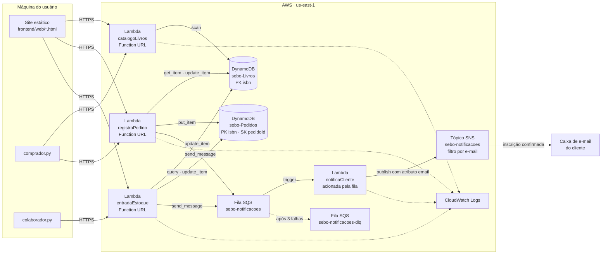
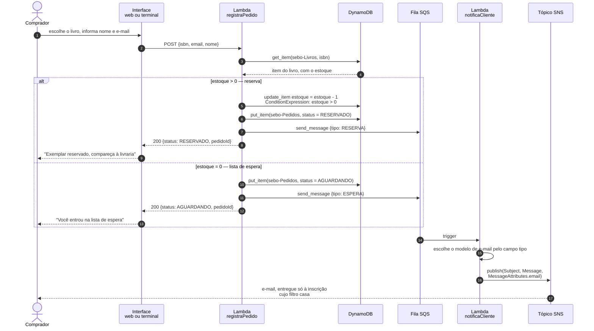
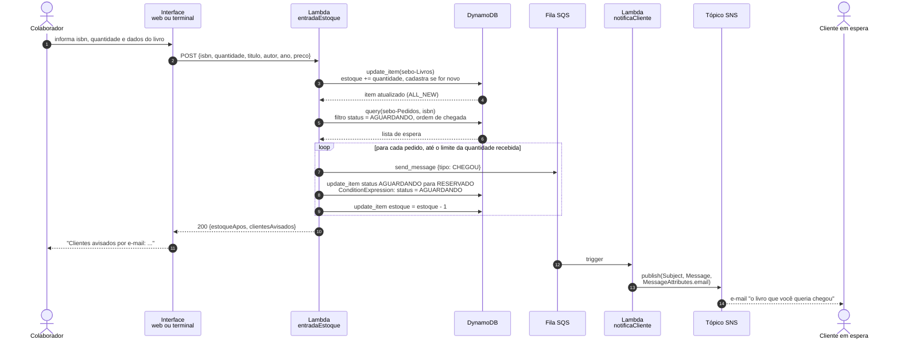

# SePUC — Livraria estilo sebo na AWS

**INF1304 — Distribuição e Concorrência**

**Integrantes:** Gustavo Rocha (2310505) e Maria Luiza Dutra (2310509)

O SePUC é um sebo online. O comprador consulta o acervo e pede um livro: se tiver exemplar,
ele é reservado na hora e o cliente recebe um e-mail avisando para ir buscar na loja; se não
tiver, ele entra em uma lista de espera e é avisado por e-mail assim que um colaborador der
entrada de um exemplar novo. Tudo roda na nuvem da Amazon, sem nenhum servidor ligado o
tempo todo.

---

## Sumário

1. [O que foi implementado](#1-o-que-foi-implementado)
2. [Diagrama de blocos](#2-diagrama-de-blocos)
3. [Diagrama UML de sequência](#3-diagrama-uml-de-sequência)
4. [Instalação — parte AWS](#4-instalação--parte-aws)
5. [Instalação — parte local (frontend)](#5-instalação--parte-local-frontend)
6. [Como operar](#6-como-operar)
7. [O que funcionou](#7-o-que-funcionou)
8. [O que não funcionou](#8-o-que-não-funcionou)

---

## 1. O que foi implementado

A aplicação é inteiramente *serverless*: **quatro funções Lambda**, **duas tabelas no
DynamoDB**, **uma fila SQS com fila morta**, **um tópico SNS** e **duas interfaces de
usuário** que rodam na máquina de quem usa.

### As quatro funções Lambda

O trabalho foi separado em quatro funções, cada uma com uma responsabilidade só. A ideia
central é que **quem decide o pedido não é quem manda o e-mail** — assim dá para mexer no
texto das mensagens sem encostar na regra de estoque, e vice-versa.

| Função | Gatilho | O que ela faz | Variáveis de ambiente |
|---|---|---|---|
| `catalogoLivros` | Function URL (GET) | Lê a tabela de livros e devolve o acervo em JSON, ordenado por título | `TABELA_LIVROS` |
| `registraPedido` | Function URL (POST) | O coração da regra de negócio: decide entre **reserva** e **lista de espera**, baixa o estoque, grava o pedido e enfileira o aviso | `TABELA_LIVROS`, `TABELA_PEDIDOS`, `FILA_NOTIFICACAO` |
| `entradaEstoque` | Function URL (POST) | A função do colaborador: cadastra ou atualiza o livro, soma ao estoque e avisa quem estava na lista de espera, em ordem de chegada | `TABELA_LIVROS`, `TABELA_PEDIDOS`, `FILA_NOTIFICACAO` |
| `notificaCliente` | Fila SQS | A única que fala com o SNS: lê a mensagem da fila, monta o e-mail a partir de um modelo e publica no tópico | `TOPICO_ARN` |

O código das quatro está em [`lambdas/`](lambdas/).

### As duas tabelas

**`sebo-Livros`** guarda o acervo e o estoque:

| Campo | Tipo | Observação |
|---|---|---|
| `isbn` | String | **Partition key** |
| `titulo` | String | Se o livro for cadastrado sem título, o ISBN é usado no lugar |
| `autor`, `ano`, `preco` | String, Number, Number | Opcionais; `preco` é gravado como `Decimal` |
| `estoque` | Number | Quantidade disponível para reserva |

**`sebo-Pedidos`** guarda todos os pedidos, reservas e esperas:

| Campo | Tipo | Observação |
|---|---|---|
| `isbn` | String | **Partition key** |
| `pedidoId` | String | **Sort key** — `<timestamp ISO em UTC>#<8 hex>` |
| `email`, `nome` | String | Para quem o aviso vai |
| `status` | String | `AGUARDANDO`, `RESERVADO` ou `CONCLUIDO` |
| `criadoEm` | String | Timestamp ISO em UTC |

Os pedidos são particionados por `isbn` porque a pergunta que a aplicação mais faz é *"quem
está esperando este livro?"* — assim isso vira um `query` direto, que lê só os pedidos
daquele livro em vez de varrer a tabela inteira. E como o `pedidoId` começa com o timestamp e o
DynamoDB ordena os itens pela sort key, a lista de espera já sai pronta na ordem de chegada:
quem pediu primeiro é avisado primeiro, sem precisar ordenar nada no código.

### Por que tem uma fila no meio do caminho

Nenhuma das funções que o usuário chama envia e-mail diretamente. A `registraPedido` e a
`entradaEstoque` apenas **colocam uma mensagem na fila** e respondem na hora; a
`notificaCliente` é acordada pela fila e cuida do envio. Isso traz duas vantagens: o
comprador não fica esperando pelo e-mail, e um aviso que falhe não se perde — depois de 3
tentativas sem sucesso ele vai parar na fila morta `sebo-notificacoes-dlq`, onde dá para ver
o que aconteceu.

### As duas corridas que precisam ser tratadas

As duas são resolvidas com condições no próprio DynamoDB, sem lock na aplicação:

- **Dois compradores disputando o último exemplar.** O decremento em `registraPedido` usa
  `ConditionExpression="estoque > :zero"`. Se os dois pedidos chegarem juntos, o segundo
  `update_item` falha em vez de deixar o estoque negativo.
- **Dois colaboradores dando entrada ao mesmo tempo.** A troca de status em `entradaEstoque`
  usa `ConditionExpression="#s = :antigo"`, exigindo que o pedido ainda esteja `AGUARDANDO`
  para virar `RESERVADO`. Se os dois processarem a mesma lista de espera, o segundo
  `update_item` falha e o mesmo cliente não é reservado duas vezes.

Os exemplares que vão para quem estava na lista de espera saem do estoque na mesma hora:
ficam guardados para quem esperou e não voltam a aparecer como disponíveis para um comprador
novo.

### As duas interfaces

Foram feitas interfaces para os dois públicos — o comprador e o colaborador da livraria — e
cada uma existe em dois formatos:

| Interface | O que é | Para quem |
|---|---|---|
| **Site** ([`frontend/web/`](frontend/web/)) | HTML, CSS e JavaScript puro, aberto direto do disco | Comprador e colaborador |
| **Terminal** ([`frontend/comprador.py`](frontend/comprador.py), [`frontend/colaborador.py`](frontend/colaborador.py)) | Scripts Python de linha de comando | Comprador e colaborador |

As duas versões conversam com as mesmas Function URLs e fazem as mesmas coisas. Nenhuma
delas usa `boto3` nem credencial da AWS: as Function URLs são endpoints HTTPS públicos,
então os frontends só fazem requisições HTTP para elas.

### Por que o CORS não foi habilitado na Function URL

A opção de CORS não foi marcada na configuração das Function URLs — ele é resolvido no
código. Cada Lambda já devolve o cabeçalho
`Access-Control-Allow-Origin: *` junto com a resposta, e o `frontend/web/api.js` manda os
POST **sem** o cabeçalho `Content-Type: application/json`. Sem esse cabeçalho o navegador
usa `text/plain`, a requisição continua sendo uma *simple request* e não acontece a
requisição de preflight `OPTIONS`, que uma Function URL sem CORS configurado não responderia
direito. Do lado da Lambda não muda nada: ela faz `json.loads(event["body"])` de qualquer
jeito.

---

## 2. Diagrama de blocos



---

## 3. Diagrama UML de sequência

### Cenário 1 — Comprador pede um livro

O fragmento `alt` cobre os dois caminhos possíveis: exemplar disponível (reserva) e sem
estoque (lista de espera).



### Cenário 2 — Colaborador dá entrada do exemplar



---

## 4. Instalação — parte AWS

Tudo foi criado em **`us-east-1`**, com o papel **`LabRole`** e o prefixo **`sebo-`** nos
nomes. A ordem abaixo é a ordem de dependência — seguindo ela, nada fica esperando por nada.

| Recurso | Nome | Observação |
|---|---|---|
| Tabela DynamoDB | `sebo-Livros` | PK `isbn` |
| Tabela DynamoDB | `sebo-Pedidos` | PK `isbn`, SK `pedidoId` |
| Fila SQS | `sebo-notificacoes` | visibility 60 s, manda para a fila morta após 3 recebimentos |
| Fila SQS | `sebo-notificacoes-dlq` | fila morta |
| Tópico SNS | `sebo-notificacoes` | inscrições por e-mail, com filtro por destinatário |
| Lambda | `catalogoLivros` | Function URL |
| Lambda | `registraPedido` | Function URL |
| Lambda | `entradaEstoque` | Function URL |
| Lambda | `notificaCliente` | acionada pela fila SQS |

### Passo 1 — Tabelas no DynamoDB

Em **DynamoDB → Tables → Create table**, duas vezes, com as chaves da tabela acima. Todo o
resto fica no default: o DynamoDB só exige declarar os atributos que são chave, e os outros
vão sendo gravados conforme a aplicação escreve.

Para a carga inicial, em **Explore table items → Create item**, cadastre alguns livros
usando [`testes/livro-exemplo.json`](testes/livro-exemplo.json) como modelo — ou use a
`entradaEstoque` depois que ela estiver pronta. **Deixe pelo menos um livro com `estoque`
igual a zero**, senão não dá para ver a lista de espera funcionando.

### Passo 2 — Fila SQS e fila morta

1. **SQS → Create queue**, tipo **Standard**, nome `sebo-notificacoes-dlq`. A fila morta
   precisa existir primeiro, porque a outra aponta para ela.
2. **Create queue** de novo, tipo **Standard**, nome `sebo-notificacoes`:
   - **Visibility timeout**: `60` segundos — pelo menos o dobro do timeout da
     `notificaCliente`, senão a mesma mensagem acaba sendo entregue duas vezes;
   - **Dead-letter queue**: *Enabled*, apontando para `sebo-notificacoes-dlq`, com
     **Maximum receives** `3`.
3. Anote a **URL** da fila principal: ela vai na variável `FILA_NOTIFICACAO`.

### Passo 3 — Tópico SNS e inscrições

1. **SNS → Topics → Create topic**, tipo **Standard**, nome `sebo-notificacoes`.
2. Aba **Subscriptions → Create subscription**: **Protocol** `Email`, **Endpoint** o e-mail
   do cliente. Uma inscrição por pessoa.
3. Cada pessoa recebe uma mensagem da AWS e precisa clicar em **Confirm subscription**.
   Enquanto a inscrição estiver *Pending confirmation*, nenhum e-mail chega.
4. **Filtro por destinatário.** Um tópico entrega a mensagem para todos os inscritos, o que
   faria cada cliente receber também os avisos dos outros. Para evitar isso, cada inscrição
   leva um filtro: selecione a inscrição, **Edit → Subscription filter policy**, escopo
   **Message attributes**, e informe:
   ```json
   { "email": ["pessoa@exemplo.com"] }
   ```
   A `notificaCliente` publica cada mensagem com o atributo `email` preenchido, e o SNS só
   entrega às inscrições cujo filtro casa.
5. Anote o **Topic ARN**: ele vai na variável `TOPICO_ARN`.

### Passo 4 — Lambda `notificaCliente`

**Lambda → Create function → Author from scratch**:

- **Function name**: `notificaCliente`
- **Runtime**: Python 3.12 · **Architecture**: x86_64
- **Change default execution role → Use an existing role → `LabRole`**
- **Não** marque Function URL — quem aciona esta função é a fila, não o usuário.

Cole o código de [`lambdas/notificaCliente.py`](lambdas/notificaCliente.py) e faça **Deploy**.
Em **Configuration → Environment variables**, crie `TOPICO_ARN` com o ARN do passo anterior.
Depois, na página da função, **+ Add trigger → SQS**, selecione `sebo-notificacoes` e clique
em **Add**.

### Passo 5 — As três Lambdas com Function URL

Crie `catalogoLivros`, `registraPedido` e `entradaEstoque` do mesmo jeito, mas em
**Additional configurations** marque **Enable function URL** com **Auth type: NONE**. Não é
preciso marcar "Configure cross-origin resource sharing (CORS)": os cabeçalhos já vêm do
código das Lambdas e o site evita a requisição de preflight.

Cole o código de [`lambdas/`](lambdas/) em cada função, faça **Deploy** e configure as
variáveis de ambiente:

| Função | Variáveis de ambiente |
|---|---|
| `catalogoLivros` | `TABELA_LIVROS = sebo-Livros` |
| `registraPedido` | `TABELA_LIVROS = sebo-Livros`<br/>`TABELA_PEDIDOS = sebo-Pedidos`<br/>`FILA_NOTIFICACAO = <URL da fila sebo-notificacoes>` |
| `entradaEstoque` | `TABELA_LIVROS = sebo-Livros`<br/>`TABELA_PEDIDOS = sebo-Pedidos`<br/>`FILA_NOTIFICACAO = <URL da fila sebo-notificacoes>` |

**Guarde as três Function URLs** — é o único valor que precisa ser copiado para o frontend.
Se alguma função for recriada, a URL muda e basta trocá-la nos dois arquivos de configuração
do próximo passo; nenhum outro arquivo precisa ser alterado.

---

## 5. Instalação — parte local (frontend)

Os dois frontends rodam na máquina de quem usa. **Não** instale `boto3` nem configure
credenciais da AWS: eles falam com as Lambdas por HTTPS.

### Primeiro, apontar para as suas Function URLs

Cole as três URLs anotadas no passo anterior nos dois arquivos de configuração —
[`frontend/config.py`](frontend/config.py), usado pelos scripts de terminal, e
[`frontend/web/config.js`](frontend/web/config.js), usado pelo site:

```python
# frontend/config.py
URL_CATALOGO = "https://xxxx.lambda-url.us-east-1.on.aws/"
URL_PEDIDO   = "https://yyyy.lambda-url.us-east-1.on.aws/"
URL_ESTOQUE  = "https://zzzz.lambda-url.us-east-1.on.aws/"
```

```javascript
// frontend/web/config.js
window.CONFIG = {
  URL_CATALOGO: "https://xxxx.lambda-url.us-east-1.on.aws/",
  URL_PEDIDO:   "https://yyyy.lambda-url.us-east-1.on.aws/",
  URL_ESTOQUE:  "https://zzzz.lambda-url.us-east-1.on.aws/",
};
```

### O site não precisa de instalação

Ele é estático e não tem dependência nenhuma. Depois de preencher o `config.js`, é só abrir
[`frontend/web/index.html`](frontend/web/index.html) no navegador — pode ser um duplo clique
no arquivo, direto do disco.

### Os clientes de terminal precisam do `requests`

Requer Python 3.8 ou superior.

```bash
cd frontend
python -m venv .venv
```

```powershell
# Windows (PowerShell)
.venv\Scripts\Activate.ps1
```

```bash
# Linux / macOS
source .venv/bin/activate
```

```bash
pip install -r requirements.txt
```

### Inscrever o cliente no tópico SNS

Antes de fazer um pedido, o cliente precisa estar inscrito no tópico e ter confirmado a
inscrição, como descrito no Passo 3. O e-mail digitado na interface precisa ser
**exatamente** o mesmo da inscrição confirmada, senão o filtro não casa e o aviso não chega.

---

## 6. Como operar

### Pelo site

1. Abra `frontend/web/index.html` e escolha **Sou comprador** ou **Sou colaborador**.
2. **Comprador** (`comprador.html`): o acervo carrega sozinho. Dá para buscar por título,
   autor ou ISBN, e cada livro mostra `N em estoque` ou `Sem estoque`. O botão abre um
   formulário pedindo nome e e-mail — ele muda de **Reservar** para **Entrar na lista de
   espera** conforme o estoque. Depois de confirmar, a página mostra a ficha do pedido com o
   status e o número do pedido, e recarrega o acervo.
3. **Colaborador** (`colaborador.html`): preencha o ISBN e a quantidade recebida. Título,
   autor, ano e preço são opcionais — **campos em branco mantêm o que já está cadastrado**,
   e um ISBN desconhecido entra como livro novo. A tabela de estoque ao lado é clicável:
   clicar em uma linha preenche o formulário com os dados daquele livro. Ao enviar, a
   resposta diz o estoque resultante e quais clientes foram avisados por e-mail.
   **Quantidade `0` serve para só corrigir os dados do livro**, sem mexer no estoque.

### Pelo terminal

Com o ambiente virtual ativo, dentro de `frontend/`:

```bash
python comprador.py
```

```
=== Sebo PUC — Comprador ===
1) Ver acervo
2) Pedir um livro
0) Sair
```

A opção **1** lista o acervo com ISBN, título, autor, ano, preço e situação do estoque. A
opção **2** pede nome, e-mail e ISBN, e imprime a resposta com o número do pedido e o
status.

```bash
python colaborador.py
```

Pergunta o ISBN, a quantidade recebida e os dados opcionais do livro (em branco mantém o que
já está cadastrado), e imprime o estoque resultante e a lista de clientes avisados.

> As Function URLs só respondem com a sessão do laboratório iniciada. Com o lab parado, as
> duas interfaces dão erro de conexão.

---

## 7. O que funcionou

- **Consulta ao acervo.** As duas interfaces listam os livros com título, autor, ano, preço
  e a situação do estoque.
- **Reserva de um livro disponível.** O comprador pede, recebe a resposta na hora com o
  número do pedido, o item é gravado em `sebo-Pedidos` como `RESERVADO`, o estoque cai em
  `sebo-Livros` e o e-mail avisando para comparecer à livraria chega na caixa do cliente.
- **Lista de espera.** Pedir um livro sem estoque grava o pedido como `AGUARDANDO` e dispara
  o e-mail confirmando a entrada na fila.
- **O aviso quando o livro chega.** Quando o colaborador dá entrada do exemplar, a
  `entradaEstoque` acha a lista de espera em ordem de chegada, enfileira o aviso, muda o
  status para `RESERVADO` e o cliente recebe o e-mail dizendo que o livro chegou. É o
  cenário mais interessante da aplicação e funciona de ponta a ponta.
- **Os dados ficam gravados para uso posterior.** O acervo e o estoque em `sebo-Livros`, e
  todo o histórico de pedidos, reservas e esperas em `sebo-Pedidos`.
- **Cada cliente recebe só o e-mail dele.** O filtro de assinatura por
  `MessageAttributes.email` está cadastrado nas inscrições do tópico.
- **Entrada e edição de livros pelo colaborador**, com os campos opcionais preservando o que
  já está gravado e ISBN desconhecido entrando como livro novo.
- **As duas guardas de concorrência.** Os `ConditionExpression` no decremento do estoque e
  na troca de status impedem estoque negativo e reserva dupla do mesmo pedido.
- **A fila morta segurando o que falhou.** O teste foi feito provocando um erro na
  `notificaCliente`: o SQS devolveu a mensagem para a fila, tentou de novo e, depois da
  terceira tentativa, moveu o aviso para a `sebo-notificacoes-dlq` em vez de deixá-lo se
  perder.

---

## 8. O que não funcionou

- **A venda efetivada não é registrada.** O `status` dos pedidos prevê o valor `CONCLUIDO`
  para marcar a compra fechada na loja, mas a tela e a função que fariam essa transição não
  foram implementadas. O controle de estoque funciona, mas o registro da venda em si teria
  que ser feito à mão na console do DynamoDB.
- **Quando dois compradores disputam o último exemplar, o segundo recebe um erro em vez de
  entrar na lista de espera.** O `ConditionExpression` cumpre o principal, que é não deixar
  o estoque negativo, mas a `ConditionalCheckFailedException` não é capturada: se o estoque
  zerar entre a leitura e a atualização, a função termina em exceção e a interface mostra
  uma mensagem de erro. O cliente precisa pedir de novo, quando o certo seria cair
  automaticamente na espera.
- **Se o e-mail informado não estiver inscrito no tópico, nada avisa.** O pedido é gravado
  normalmente e a tela diz que deu certo, mas o e-mail simplesmente não chega, porque o
  filtro da inscrição não casa com nenhum destinatário. A aplicação não verifica isso.
